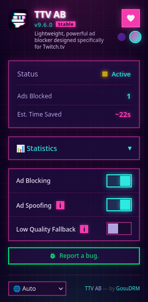
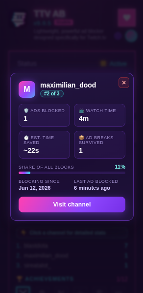
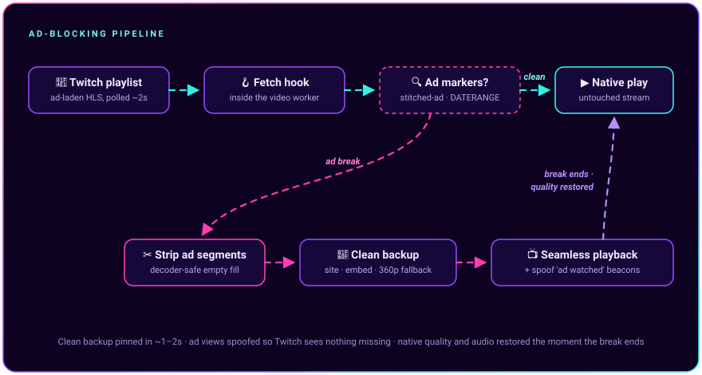

# TTV AB


[](https://github.com/GosuDRM/TTV-AB)

A lightweight browser extension that blocks Twitch ads on live streams and VODs while keeping playback stable.

## 📥 Install

> **⚠️ Supported browsers: Firefox and Chromium-based desktop browsers only.** TTV AB can't run on WebKit-based browsers like Orion, or on anything on iOS/iPadOS (every iOS browser is WebKit under the hood). The ad-blocker can't load there and the player goes to a black screen, so please use Firefox or a Chromium-based browser on a computer.

| Store | Link | Status |
|-------|------|--------|
| Firefox Add-ons | [TTV AB - Twitch Ad Blocker](https://addons.mozilla.org/en-GB/firefox/addon/ttv-ab-twitch-ad-blocker/) | Stable |
| Chrome Web Store | [TTV AB - Lightweight, powerful ad blocker](https://chromewebstore.google.com/detail/ttv-ab-lightweight-powerf/mlifbfmeoafhcccmppaolojdglcbkdkg) | Stable |


<p align="center">
  
  
</p>

## ✨ Features

- ✅ Blocks preroll and midroll ads on live streams and Twitch VODs
- ✅ Keeps a clean backup stream playing during ad breaks to reduce black screens, purple screens, and stalls
- ✅ Returns to native video quality and audio after recovery, including enhanced HEVC and AV1 qualities when available
- ✅ Keeps recovery working in background tabs and Picture-in-Picture
- ✅ Removes stale Twitch ad overlays after playback returns
- ✅ Independent, live-updating controls for Ad Blocking, Ad Spoofing, and Low Quality Fallback
- ✅ Optional Ad Spoofing to reduce anti-adblock detection
- ✅ Optional Low Quality Fallback for faster recovery; disabling it prioritizes normal-quality sources, with a temporary clean low-quality bridge available during prerolls and midrolls
- ✅ Optional Ad Break Timer in the stream's top-right corner, disabled by default
- ✅ Optional Turbo Mode that pauses new statistics and achievements while preserving existing history and all ad-blocking controls
- ✅ Persistent, live-updating Ads Blocked and Time Saved totals
- ✅ Statistics dashboard with a 7-day chart, detailed per-channel history, JSON export, reset, and **12 Achievement Badges**
- ✅ Language selector, with 12 languages supported (EN, ES, FR, DE, PT, IT, JA, KO, ZH-CN, ZH-TW, RU, UK)
- ✅ Built-in Generate Log tool that creates a local, privacy-filtered diagnostic file for bug reports
- ✅ Accessible Manifest V3 popup with Retro and Neon themes
- ✅ Supports Firefox and Chromium-based desktop browsers

## 🚀 Usage

1. Install the extension from your browser's add-on store
2. Navigate to [twitch.tv](https://twitch.tv) and open any live stream or VOD
3. Ads are blocked automatically, no configuration needed
4. Click the extension icon to view stats or toggle Ad Blocking, Ad Spoofing, Low Quality Fallback, and Ad Break Timer
5. Change language via the dropdown in the popup footer

## ⚙️ How It Works

TTV AB checks Twitch's HLS playlists before playback and blocks recognized client-side ad requests on VODs.

<p align="center">
  
</p>

- Checks alternative Twitch sources one at a time, using a fresh clean native playlist or a compatible silent hold while searching
- Plays only verified, playable, ad-free backups, refreshes them during the break, and rotates stalled sources
- Continues each switch between sources, including the return to native, from the point the live stream reached, so playback does not jump back
- Returns to native playback after repeated clean checks for the same stream and break, then restores quality and audio settings
- Keeps recovery tied to the current player across background tabs and Picture-in-Picture, respecting explicit pauses

**Low Quality Fallback** is on by default, allowing a clean 360p bridge sooner while higher-quality sources are checked. Turning it off prioritizes normal-quality sources; prerolls and midrolls may still use a temporary clean low-quality bridge if those sources fail. Other sources may still offer lower qualities.

**Ad Spoofing** sends Twitch progress and completion signals for blocked ads and, outside midrolls, requests the blocked ad's segments in the background. Turning it off stops both and leaves ad blocking active.

The optional **Ad Break Timer** is off by default and can be switched on in the popup. It tracks the current break until it ends; it does not predict when your selected quality will return.

## 🔔 What's New

### v23.0.3 - 2026-10-17

- **Player Crash Recovery** - Reload the player once by itself when Twitch's video player crashes, instead of waiting and then asking you to refresh the tab. If that reload does not bring the stream back, the refresh notice appears without another reload, so a crash can never start a reload loop.
- **Smaller Extension** - Remove code that never ran, including an unused player-type override that inspected every Twitch request, so pages load less code and Twitch requests skip a needless check.

### v23.0.2 - 2026-10-16

- **Backup Search Outcome** - Finish a backup search with the backup a newer refresh just updated, and log it, instead of ending silently with no result when that refresh lands during the search.
- **Statistics After Extension Updates** - Stop retrying to save statistics, and filling the console with errors, in tabs left open during an update or reload. Those statistics are saved once you refresh the page.
- **Slow Backup Sources** - Give up on a backup source that does not answer within 8 seconds, cancel its requests, and check the next source, so one slow Twitch request no longer keeps an ad break on the silent hold.
- **Time Saved for More Ads** - Count ads that Twitch marks with an end time instead of a duration, so they are no longer missing from Time Saved.
- **Log Download Message** - Say that the debug log download started and where to find it, with a Save again button, in browsers that download the file directly, instead of claiming the file was saved.
- **Translated Log Errors** - Show debug log export errors in your language.
- **Leaving Recovery Mode** - Turn off the emergency playlist protection once playback works again, also after you switch channels, after a crash on a page without a stream, or when another script has wrapped the page's network requests, instead of keeping it on until you refresh the tab.
- **Recovery Notice** - Keep the refresh notice on screen until you come back to a background tab, and show it in your browser's language.
- **Reduced Quality List Diagnostics** - Show how many qualities Twitch offered, the highest one, which Twitch player asked for them, and whether the page was visible when the full quality list is restored after Twitch sends a shorter one.
- **Return to Live Diagnostics** - Log when the stream returns after an ad break with a quick pause and resume, and why the smoother playlist return was not possible.
- **Backup Search Diagnostics** - Log why a backup search stopped early, and stop naming the previous break's backup as the one being replaced when a new break starts.
- **Time Saved Diagnostics** - Show how many ads each ad break added to Time Saved and for how long in the log, note ads Twitch did not give a usable duration, and log when Twitch declares two different durations for an ad.
- **Debug Log Details** - Record your operating system, which video codecs your browser can decode, your Ad Break Timer and Turbo settings, whether the extension can access twitch.tv, and your local time in debug logs, and explain why a Twitch tab could not be read.
- **Bug Report Form** - Open a new GitHub bug report with your version, browser, and operating system already filled in.
- **Recovery Status in Debug Logs** - Show the current recovery stage, how many of the three player restarts were used, and whether the emergency playlist protection is on.
- **Lighter Player Checks** - Skip plain page elements when looking for Twitch's player, so the regular playback checks use less CPU while you watch.
- **Long Time Saved Totals** - Show Time Saved in days, hours, minutes, and seconds once it passes a day.
- **Longer Debug Logs** - Keep the last 3,000 events per tab instead of 1,000, so a debug log covers more ad breaks.

### v23.0.1 - 2026-10-15

- **Settings After Updates** - Keep your Low Quality Fallback and Ad Break Timer choices when TTV AB updates instead of resetting them with every release.
- **Setting Explanations** - Shorten and update the Ad Spoofing, Low Quality Fallback, and Ad Break Timer explanations in all 12 languages. Ad Spoofing now mentions the ad segment requests it controls, and Low Quality Fallback explains the one player restart after a break that ends at 360p and the slower start to breaks when it is off.
- **Explanation Scrolling** - Let every setting explanation scroll in a short popup so its Got it button stays reachable.
- **Keyboard Access** - Open the Ad Spoofing and Low Quality Fallback explanations from the keyboard with their names read in your language, close any explanation with Escape, and show a clear focus ring on the language selector and Got it buttons.
- **Reduced Motion** - Stop the Retro theme's description shimmer and theme dot pulse and the achievement toast's animations when your system asks for reduced motion.
- **Achievement Toast Flicker** - Stop the achievement toast from briefly reappearing just before it disappears.
- **Ukrainian Store Listing** - Fix a double space in the extension name and a misspelled word in the description.
- **Channel Ad Breaks** - Show a channel's real number of ad breaks in its details instead of a third of it.
- **New Channels in Statistics** - Keep new channels in your statistics once 100 channels are tracked, making room from the channels you have not watched for the longest time while always keeping your top five.
- **Statistics in Embedded Players** - Keep counting ads and watch time in Twitch players embedded on other sites when the browser blocks their site storage, instead of losing them.
- **VOD Watch Time** - Count watch time for VODs and credit blocked VOD ads to the channel that streamed them. TTV AB asks Twitch once which channel a VOD belongs to.
- **Delayed Statistics** - Record statistics delivered after a browser restart on the day they happened instead of the day they arrived.
- **Time Zone Changes** - Keep today's statistics when you move to an earlier time zone or your clock goes back.
- **Time Saved Display** - Show Time Saved in whole seconds.
- **Low Quality Fallback Diagnostics** - Log once per ad break when Low Quality Fallback is off and the break is not identified as a preroll or midroll, which leaves the 360p fallback unavailable.
- **Individual Ads** - Count each blocked ad as well as each ad break, shown in a channel's details and the daily chart. Ads blocked before this update are not included.
- **Daily History** - Hover a day in the chart to see its ad breaks, ads, Time Saved, and watch time.
- **Reset Statistics** - Clear your counters, history, channel statistics, and achievements from the Statistics panel after confirming, without changing your settings.
- **Export Statistics** - Save your statistics as a JSON file from the Statistics panel.
- **Retro Colors** - Show Time Saved in light orange, and the Status text in light green when active and gray when inactive, in the Retro theme.
- **Last 7 Days** - Show the last 7 days in the chart instead of starting over every Monday, and leave today out of the daily average since the day is not over.
- **Fewer Statistics Writes** - Save watch time once a minute instead of every 15 seconds and save only what changed, so the browser writes to disk less often.

_See [CHANGELOG.md](CHANGELOG.md) for the complete list of changes._

## 🛠️ Development

Use the `main` branch for Chrome or `firefox` for Firefox. With Node.js 22 and Python 3 installed, `npm ci` installs dependencies and `npm run build` creates `dist/` and the browser packages.

Edit the TypeScript source, never `dist/`:

- `src/modules/`: stream handling, ad blocking, and playback recovery
- `src/scripts/`: background script and page bridge
- `src/popup/`: popup, themes, and translations
- `tests/`: regression tests

Tests read `dist/`, so build before running the checks:

```sh
npm run build && npm test && npm run test:shuffle && npm run lint && npm run typecheck && npm run knip
```

To try a build, [load `dist/` unpacked](https://developer.chrome.com/docs/extensions/get-started/tutorial/hello-world#load-unpacked) in Chrome, or [load `dist/manifest.json` as a temporary add-on](https://extensionworkshop.com/documentation/develop/temporary-installation-in-firefox/) in Firefox. After each rebuild, reload the extension and refresh the Twitch tab.

Keep pull requests focused, add a regression test for each bug fix, check playback changes on Twitch, and list what you tested and what you could not.

<details>
<summary>Build and release notes</summary>

- **Firefox popup files:** The `firefox` branch tracks compiled `src/popup/popup.js` and `translations.js`. If the build reports them out of sync, copy both from `dist/src/popup/` and rebuild.
- **Packages:** The manifest decides which archives the build creates. Packaging errors stop the build.
- **Releases:** Annotated release tags include `Firefox-Commit: <full SHA>`, and the release workflow builds Firefox from that commit.

</details>

## 💬 Support

- Found a bug? [Open an issue](https://github.com/GosuDRM/TTV-AB/issues)
- For playback repeats or gaps, use **Generate Log** in the affected tab after the issue occurs. `[Continuity]` entries record accepted transitions, rejected windows, and timestamp gaps or overlaps, with numbered sources instead of signed URLs. Repeated matching events are summarized at most once every five seconds. These playlist timestamps do not prove what was played or whether audio stayed in sync; include when you noticed the issue.
- Want to contribute? Pull requests are welcome
- If TTV AB saves you from ads, consider supporting development:

[](https://ko-fi.com/gosudrm)

## 🔒 Privacy

TTV AB operates entirely on your device. No data is ever sent to external servers: not your browsing history, not your Twitch activity, not your ad-block statistics. All counters and settings are stored in your browser's local storage. See [PRIVACY.md](PRIVACY.md) for the full privacy policy.

## 📄 License

This project uses an MIT-based license with a repository attribution requirement. See [LICENSE](LICENSE) for details.
