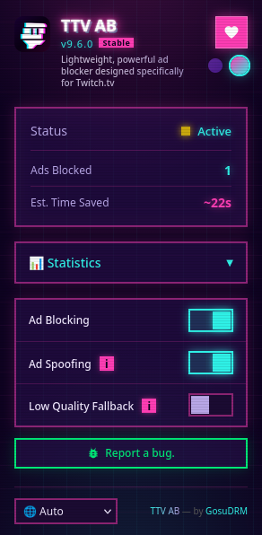
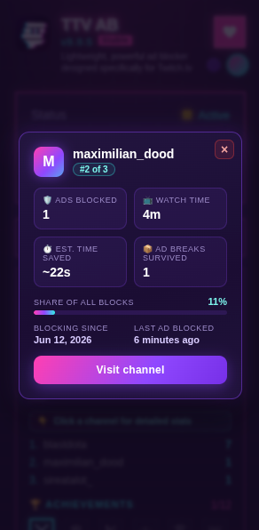
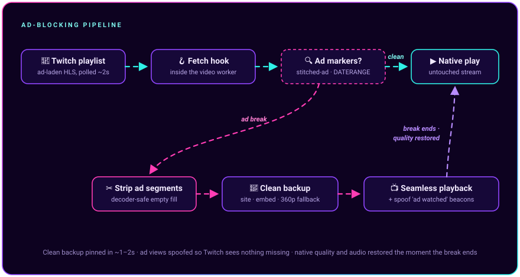

# TTV AB


[](https://github.com/GosuDRM/TTV-AB)

A lightweight browser extension that blocks Twitch ads on live streams and VODs while keeping playback stable.

## 📥 Install

> **⚠️ Supported browsers: Firefox 142 or newer and Chromium-based desktop browsers built on Chromium 111 or newer only.** TTV AB can't run on WebKit-based browsers like Orion, or on anything on iOS/iPadOS (every iOS browser is WebKit under the hood). The ad-blocker can't load there and the player goes to a black screen, so please use Firefox or a Chromium-based browser on a computer.

| Store | Link | Status |
|-------|------|--------|
| Firefox Add-ons | [TTV AB - Twitch Ad Blocker](https://addons.mozilla.org/en-GB/firefox/addon/ttv-ab-twitch-ad-blocker/) | Stable |
| Chrome Web Store | [TTV AB - Lightweight, powerful ad blocker](https://chromewebstore.google.com/detail/ttv-ab-lightweight-powerf/mlifbfmeoafhcccmppaolojdglcbkdkg) | Stable |


<p align="center">
  
  
</p>

## ✨ Features

- ✅ Blocks preroll and midroll ads on live streams and Twitch VODs
- ✅ Keeps a clean backup stream playing during ad breaks to reduce black screens, purple screens, and stalls
- ✅ Returns to native video quality and audio after recovery, including enhanced HEVC and AV1 qualities when available
- ✅ Keeps recovery working in background tabs and Picture-in-Picture
- ✅ Removes stale Twitch ad overlays after playback returns
- ✅ Independent, live-updating controls for Ad Blocking, Ad Spoofing, and Low Quality Fallback
- ✅ Optional Ad Spoofing to reduce anti-adblock detection
- ✅ Optional Low Quality Fallback for faster recovery; disabling it prioritizes normal-quality sources, with a temporary clean low-quality bridge available during prerolls and midrolls
- ✅ Optional Ad Break Timer in the stream's top-right corner, disabled by default
- ✅ Optional Turbo Mode that pauses new statistics and achievements while preserving existing history and all ad-blocking controls
- ✅ Persistent, live-updating Ads Blocked and Time Saved totals
- ✅ Statistics dashboard with a 7-day chart, detailed per-channel history, JSON export, reset, and **12 Achievement Badges**
- ✅ Language selector, with 12 languages supported (EN, ES, FR, DE, PT, IT, JA, KO, ZH-CN, ZH-TW, RU, UK)
- ✅ Built-in Generate Log tool that creates a local, privacy-filtered diagnostic file for bug reports
- ✅ Accessible Manifest V3 popup with Retro and Neon themes
- ✅ Supports Firefox and Chromium-based desktop browsers

## 🚀 Usage

1. Install the extension from your browser's add-on store
2. Navigate to [twitch.tv](https://twitch.tv) and open any live stream or VOD
3. Ads are blocked automatically, no configuration needed
4. Click the extension icon to view stats or toggle Ad Blocking, Ad Spoofing, Low Quality Fallback, and Ad Break Timer
5. Change language via the dropdown in the popup footer

## ⚙️ How It Works

TTV AB checks Twitch's HLS playlists before playback and blocks recognized client-side ad requests on VODs.

<p align="center">
  
</p>

- Checks alternative Twitch sources one at a time, using a fresh clean native playlist or a compatible silent hold while searching
- Plays only verified, playable, ad-free backups, refreshes them during the break, and rotates stalled sources
- Continues each switch between sources, including the return to native, from the point the live stream reached, so playback does not jump back
- Returns to native playback after repeated clean checks for the same stream and break, then restores quality and audio settings
- Keeps recovery tied to the current player across background tabs and Picture-in-Picture, respecting explicit pauses

**Low Quality Fallback** is on by default, allowing a clean 360p bridge sooner while higher-quality sources are checked. Turning it off prioritizes normal-quality sources; prerolls and midrolls may still use a temporary clean low-quality bridge if those sources fail. Other sources may still offer lower qualities.

**Ad Spoofing** sends Twitch progress and completion signals for blocked ads and, outside midrolls, requests the blocked ad's segments in the background. Turning it off stops both and leaves ad blocking active.

The optional **Ad Break Timer** is off by default and can be switched on in the popup. It tracks the current break until it ends; it does not predict when your selected quality will return.

## 🔔 What's New

### v28.0.1 - 2026-11-26

- **Update Notice** - The Stable label next to the version changes to Update available when your browser's add-on store has a newer version, and clicking it explains how to get it. The popup checks at most once an hour, and only while it is open.
- **Debug Logs From Before a Refresh** - Include the last saved log details from before you refreshed a Twitch tab, so a problem that made you refresh can still be traced.
- **Video Error Details** - Record in debug logs the video error the browser reports, such as error 4000, with its message, even after Twitch's player clears it.
- **Current Stream Summary** - Show in debug logs whether each tab is playing Twitch's stream, an ad-free replacement, or the silent hold, along with the stream's format and qualities.
- **Playback Diagnostics** - Record in debug logs when the browser refuses to start playback and when a stream request fails shortly after an ad break.
- **Longer Logs for Frozen Tabs** - Keep about four times as many log entries for a tab that stops responding, and say clearly when older entries were not saved.
- **Shorter Debug Logs** - Record one line per search for an ad-free replacement stream instead of several lines for every stream checked, so logs reach further back.
- **Exact Browser Version** - Show the browser's full version in debug logs and bug reports instead of the shortened one Chromium browsers report, and recognize Brave even when it presents itself as Chrome.

### v28.0.0 - 2026-11-26

- **Error 4000 During Ad Breaks in Chromium Browsers** - Show the short silent hold when no ad-free replacement stream is ready, in Chrome, Edge, Brave, and other Chromium browsers on channels Twitch delivers as fragmented MP4 video, instead of stopping playback with a player error, such as error 4000, until the ads ended, even after refreshing the page. ([#107](https://github.com/GosuDRM/TTV-AB/issues/107))
- **Ad Breaks After a Background Tab Slowdown** - Resume full ad break handling when Twitch's player was wrongly treated as stopped while its tab was in the background but kept playing, instead of ignoring it for the rest of the visit, which slowed every search for an ad-free stream by several seconds. ([#106](https://github.com/GosuDRM/TTV-AB/issues/106))
- **Stream Shrinking During Some Ads** - Stop Twitch from starting ads that shrink the stream into a corner beside a blank ad area, so the stream stays full size and keeps playing. ([#108](https://github.com/GosuDRM/TTV-AB/issues/108))
- **Extra Requests at the Start of Some Ad Breaks** - Wait the usual retry delay before checking every ad-free replacement stream again when none was found at the start of a break, instead of repeating the whole check right away, which doubled the requests to Twitch.
- **Post-Ad Rebuild Diagnostics** - Record in debug logs, before each extra player rebuild after an ad break, the state of the video and when the stream last delivered new data, to help track down tabs that freeze after a break.
- **Background Tab Diagnostics** - Record in debug logs when a tab comes back into view during an ad break after its player stopped receiving the stream while hidden, to help track down breaks that stay black in background tabs.

### v27.0.2 - 2026-11-20

- **Bottom Promotion Banners** - Hide the promotion banners Twitch shows along the bottom of the page, such as the GTA VI banner, and the GTA VI animation that crosses the bottom of the screen every 10 to 30 minutes, while ad blocking is on. Terms of service and cookie prompts stay visible.

_See [CHANGELOG.md](CHANGELOG.md) for the complete list of changes._

## 🛠️ Development

Use the `main` branch for Chrome or `firefox` for Firefox. With Node.js 22 and Python 3 installed, `npm ci` installs dependencies and `npm run build` creates `dist/` and the browser packages.

Edit the TypeScript source, never `dist/`:

- `src/modules/`: stream handling, ad blocking, and playback recovery
- `src/scripts/`: background script and page bridge
- `src/popup/`: popup, themes, and translations
- `tests/`: regression tests

Tests read `dist/`, so build before running the checks:

```sh
npm run build && npm test && npm run test:shuffle && npm run lint && npm run typecheck && npm run knip
```

To try a build, [load `dist/` unpacked](https://developer.chrome.com/docs/extensions/get-started/tutorial/hello-world#load-unpacked) in Chrome, or [load `dist/manifest.json` as a temporary add-on](https://extensionworkshop.com/documentation/develop/temporary-installation-in-firefox/) in Firefox. After each rebuild, reload the extension and refresh the Twitch tab.

Keep pull requests focused, add a regression test for each bug fix, check playback changes on Twitch, and list what you tested and what you could not.

<details>
<summary>Build and release notes</summary>

- **Firefox popup files:** The `firefox` branch tracks compiled `src/popup/popup.js` and `translations.js`. If the build reports them out of sync, copy both from `dist/src/popup/` and rebuild.
- **Packages:** The manifest decides which archives the build creates. Packaging errors stop the build.
- **Releases:** Annotated release tags include `Firefox-Commit: <full SHA>`, and the release workflow builds Firefox from that commit.

</details>

## 💬 Support

- Found a bug? [Open an issue](https://github.com/GosuDRM/TTV-AB/issues)
- For playback repeats or gaps, use **Generate Log** in the affected tab after the issue occurs. `[Continuity]` entries record accepted transitions, rejected windows, and timestamp gaps or overlaps, with numbered sources instead of signed URLs. Repeated matching events are summarized at most once every five seconds. These playlist timestamps do not prove what was played or whether audio stayed in sync; include when you noticed the issue.
- Want to contribute? Pull requests are welcome
- If TTV AB saves you from ads, consider supporting development:

[](https://ko-fi.com/gosudrm)

## 🔒 Privacy

TTV AB operates entirely on your device. No data is ever sent to external servers: not your browsing history, not your Twitch activity, not your ad-block statistics. All counters and settings are stored in your browser's local storage. See [PRIVACY.md](PRIVACY.md) for the full privacy policy.

## 📄 License

This project uses an MIT-based license with a repository attribution requirement. See [LICENSE](LICENSE) for details.
