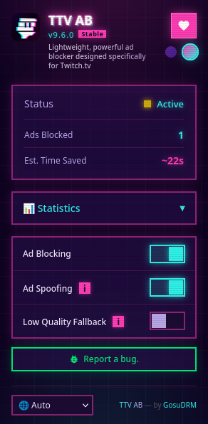
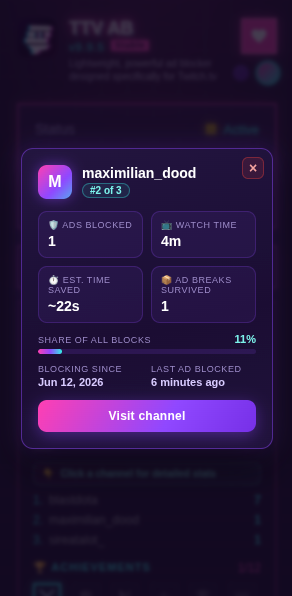
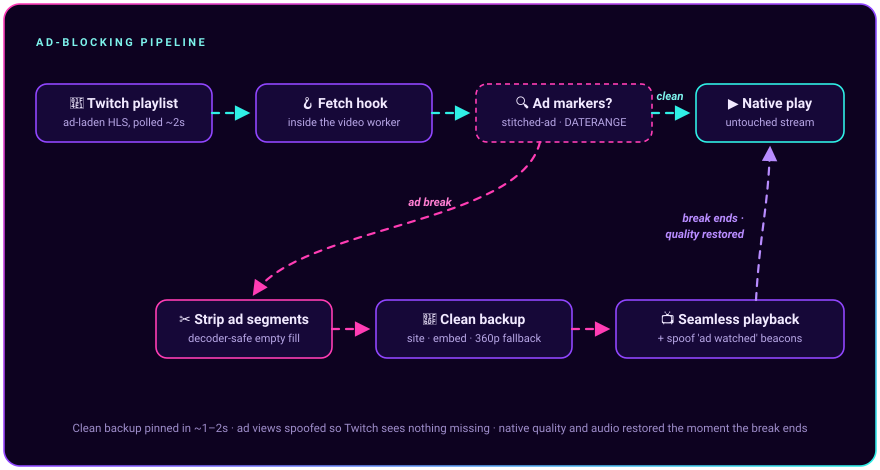

# TTV AB


[](https://github.com/GosuDRM/TTV-AB)

A lightweight browser extension that blocks Twitch ads on live streams and VODs while keeping playback stable.

## 📥 Install

> **⚠️ Supported browsers: Firefox 142 or newer and Chromium-based desktop browsers built on Chromium 111 or newer only.** TTV AB can't run on WebKit-based browsers like Orion, or on anything on iOS/iPadOS (every iOS browser is WebKit under the hood). The ad-blocker can't load there and the player goes to a black screen, so please use Firefox or a Chromium-based browser on a computer.

| Store | Link | Status |
|-------|------|--------|
| Firefox Add-ons | [TTV AB - Twitch Ad Blocker](https://addons.mozilla.org/en-GB/firefox/addon/ttv-ab-twitch-ad-blocker/) | Stable |
| Chrome Web Store | [TTV AB - Lightweight, powerful ad blocker](https://chromewebstore.google.com/detail/ttv-ab-lightweight-powerf/mlifbfmeoafhcccmppaolojdglcbkdkg) | Stable |


<p align="center">
  
  
</p>

## ✨ Features

- ✅ Blocks preroll and midroll ads on live streams and Twitch VODs
- ✅ Keeps a clean backup stream playing during ad breaks to reduce black screens, purple screens, and stalls
- ✅ Returns to native video quality and audio after recovery, including enhanced HEVC and AV1 qualities when available
- ✅ Keeps recovery working in background tabs and Picture-in-Picture
- ✅ Removes stale Twitch ad overlays after playback returns
- ✅ Independent, live-updating controls for Ad Blocking, Ad Spoofing, and Low Quality Fallback
- ✅ Optional Ad Spoofing to reduce anti-adblock detection
- ✅ Optional Low Quality Fallback for faster recovery; disabling it prioritizes normal-quality sources, with a temporary clean low-quality bridge available during prerolls and midrolls
- ✅ Optional Ad Break Timer in the stream's top-right corner, disabled by default
- ✅ Optional Turbo Mode that pauses new statistics and achievements while preserving existing history and all ad-blocking controls
- ✅ Persistent, live-updating Ads Blocked and Time Saved totals
- ✅ Statistics dashboard with a 7-day chart, detailed per-channel history, JSON export, reset, and **12 Achievement Badges**
- ✅ Language selector, with 12 languages supported (EN, ES, FR, DE, PT, IT, JA, KO, ZH-CN, ZH-TW, RU, UK)
- ✅ Built-in Generate Log tool that creates a local, privacy-filtered diagnostic file for bug reports
- ✅ Accessible Manifest V3 popup with Retro and Neon themes
- ✅ Supports Firefox and Chromium-based desktop browsers

## 🚀 Usage

1. Install the extension from your browser's add-on store
2. Navigate to [twitch.tv](https://twitch.tv) and open any live stream or VOD
3. Ads are blocked automatically, no configuration needed
4. Click the extension icon to view stats or toggle Ad Blocking, Ad Spoofing, Low Quality Fallback, and Ad Break Timer
5. Change language via the dropdown in the popup footer

## ⚙️ How It Works

TTV AB checks Twitch's HLS playlists before playback and blocks recognized client-side ad requests on VODs.

<p align="center">
  
</p>

- Checks alternative Twitch sources one at a time, using a fresh clean native playlist or a compatible silent hold while searching
- Plays only verified, playable, ad-free backups, refreshes them during the break, and rotates stalled sources
- Continues each switch between sources, including the return to native, from the point the live stream reached, so playback does not jump back
- Returns to native playback after repeated clean checks for the same stream and break, then restores quality and audio settings
- Keeps recovery tied to the current player across background tabs and Picture-in-Picture, respecting explicit pauses

**Low Quality Fallback** is on by default, allowing a clean 360p bridge sooner while higher-quality sources are checked. Turning it off prioritizes normal-quality sources; prerolls and midrolls may still use a temporary clean low-quality bridge if those sources fail. Other sources may still offer lower qualities.

**Ad Spoofing** sends Twitch progress and completion signals for blocked ads and, outside midrolls, requests the blocked ad's segments in the background. Turning it off stops both and leaves ad blocking active.

The optional **Ad Break Timer** is off by default and can be switched on in the popup. It tracks the current break until it ends; it does not predict when your selected quality will return.

## 🔔 What's New

### v26.0.3 - 2026-11-06

- **Brief Restart When Ad Breaks End** - Return to the stream without pausing and resuming the player when the ad-free replacement already matches the stream's quality, instead of a short restart at the end of every break with Low Quality Fallback off.
- **Picture-by-Picture Player During Ads** - Leave Twitch's small picture-by-picture player on its own stream, so it no longer loads a second 1080p stream or disrupts the main player's ad-free replacement.
- **Freeze at a Missing Segment** - Skip a hole of up to two and a half seconds in the buffered video after about a second of frozen video outside ad breaks, instead of staying frozen for several seconds.

### v26.0.2 - 2026-11-04

- **Freeze at the Start of Some Ad Breaks** - Switch to the ad-free replacement stream as soon as it is found when it starts slightly behind the stream, skipping ahead up to about a second and a half instead of freezing for several seconds while waiting for it to catch up.
- **Shorter Replays When Switching Streams** - Repeat at most half a second of already watched video when switching to or from the ad-free replacement stream, instead of up to a second.
- **Freeze at Small Gaps During Ad Breaks** - Skip a gap of up to a second in the buffered video after about a second of frozen video during an ad break, instead of staying frozen for about 3 seconds.

### v26.0.1 - 2026-10-30

- **Brief Freeze When Ads End** - End ad breaks without reloading the player on channels Twitch delivers as fragmented MP4 video, instead of a second of no video at the end of every break.
- **Ad Break Start on More Channels** - Keep the stream moving at the start of an ad break on channels Twitch delivers as fragmented MP4 video, with a short silent hold when the ad-free replacement stream is not ready yet, instead of risking a stall or black screen.
- **Faster HD During Ad Breaks** - Switch from the low-quality bridge to the HD replacement stream about 8 seconds into a break instead of about 17, while still letting the bridge buffer for its full 8 seconds first.
- **Ad Break Diagnostics** - Record in debug logs how long the player took to show video again after a reload at the end of a break, keep Twitch's second player apart from the main player in stream switch details, and log the stream's clock lead only when it changes.

_See [CHANGELOG.md](CHANGELOG.md) for the complete list of changes._

## 🛠️ Development

Use the `main` branch for Chrome or `firefox` for Firefox. With Node.js 22 and Python 3 installed, `npm ci` installs dependencies and `npm run build` creates `dist/` and the browser packages.

Edit the TypeScript source, never `dist/`:

- `src/modules/`: stream handling, ad blocking, and playback recovery
- `src/scripts/`: background script and page bridge
- `src/popup/`: popup, themes, and translations
- `tests/`: regression tests

Tests read `dist/`, so build before running the checks:

```sh
npm run build && npm test && npm run test:shuffle && npm run lint && npm run typecheck && npm run knip
```

To try a build, [load `dist/` unpacked](https://developer.chrome.com/docs/extensions/get-started/tutorial/hello-world#load-unpacked) in Chrome, or [load `dist/manifest.json` as a temporary add-on](https://extensionworkshop.com/documentation/develop/temporary-installation-in-firefox/) in Firefox. After each rebuild, reload the extension and refresh the Twitch tab.

Keep pull requests focused, add a regression test for each bug fix, check playback changes on Twitch, and list what you tested and what you could not.

<details>
<summary>Build and release notes</summary>

- **Firefox popup files:** The `firefox` branch tracks compiled `src/popup/popup.js` and `translations.js`. If the build reports them out of sync, copy both from `dist/src/popup/` and rebuild.
- **Packages:** The manifest decides which archives the build creates. Packaging errors stop the build.
- **Releases:** Annotated release tags include `Firefox-Commit: <full SHA>`, and the release workflow builds Firefox from that commit.

</details>

## 💬 Support

- Found a bug? [Open an issue](https://github.com/GosuDRM/TTV-AB/issues)
- For playback repeats or gaps, use **Generate Log** in the affected tab after the issue occurs. `[Continuity]` entries record accepted transitions, rejected windows, and timestamp gaps or overlaps, with numbered sources instead of signed URLs. Repeated matching events are summarized at most once every five seconds. These playlist timestamps do not prove what was played or whether audio stayed in sync; include when you noticed the issue.
- Want to contribute? Pull requests are welcome
- If TTV AB saves you from ads, consider supporting development:

[](https://ko-fi.com/gosudrm)

## 🔒 Privacy

TTV AB operates entirely on your device. No data is ever sent to external servers: not your browsing history, not your Twitch activity, not your ad-block statistics. All counters and settings are stored in your browser's local storage. See [PRIVACY.md](PRIVACY.md) for the full privacy policy.

## 📄 License

This project uses an MIT-based license with a repository attribution requirement. See [LICENSE](LICENSE) for details.
